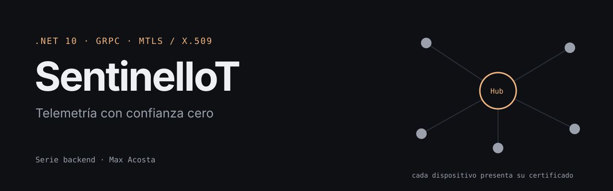

# Sentinel IoT (Edición Linux/Zero Trust)

<p align="center"></p>

Sistema de telemetría IoT seguro con arquitectura Zero Trust, construido con .NET 10, gRPC y autenticación mTLS (Mutual TLS) mediante certificados X.509.

## Descripción

Sentinel IoT es una solución cliente-servidor diseñada para la recolección segura de datos de telemetría desde dispositivos IoT remotos. El sistema implementa autenticación mutua mediante certificados X.509, garantizando que solo dispositivos autorizados puedan comunicarse con el Hub y viceversa.

### Características Principales

- **Autenticación mTLS**: Comunicación segura mediante certificados X.509
- **gRPC sobre HTTP/2**: Alto rendimiento y eficiencia en la transmisión de datos
- **SQLite**: Base de datos ligera y portable para almacenamiento local
- **Arquitectura Zero Trust**: Verificación de identidad en cada conexión
- **API REST**: Endpoint para consultar datos de telemetría almacenados

## Arquitectura

```
┌─────────────────┐         gRPC (HTTP/2 + mTLS)        ┌─────────────────┐
│                 │ ────────────────────────────────────> │                 │
│  IoT Sensor     │                                       │  IoT Hub        │
│  (Cliente)      │ <─────────────────────────────────── │  (Servidor)     │
│                 │         MetricAck                    │                 │
└─────────────────┘                                       └─────────────────┘
                                                                    │
                                                                    │ Entity Framework
                                                                    │ Core (SQLite)
                                                                    ▼
                                                          ┌─────────────────┐
                                                          │  SQLite        │
                                                          │  (sentinel_    │
                                                          │   linux.db)    │
                                                          └─────────────────┘
```

### Componentes

- **Sentinel.IoT.Hub**: Servidor gRPC que recibe y almacena datos de telemetría en SQLite
- **Sentinel.IoT.Sensor**: Cliente simulado de dispositivo IoT que envía lecturas de sensores al Hub

## Stack Tecnológico

- **.NET 10.0**: Framework .NET más reciente
- **gRPC**: Framework RPC de alto rendimiento para comunicación de telemetría
- **Entity Framework Core**: ORM para operaciones de base de datos
- **SQLite**: Base de datos embebida y ligera
- **Protocol Buffers**: Formato de serialización eficiente para mensajes gRPC
- **OpenSSL**: Herramienta para generar certificados X.509

## Pre-requisitos

Antes de comenzar, asegúrate de tener instalado:

- [.NET 10 SDK](https://dotnet.microsoft.com/download/dotnet/10.0) o superior
- [OpenSSL](https://www.openssl.org/) (generalmente incluido en distribuciones Linux)
- [dotnet-ef](https://docs.microsoft.com/ef/core/cli/dotnet) (herramienta de Entity Framework Core)

### Instalar dotnet-ef

```bash
dotnet tool install --global dotnet-ef
```

## Instalación

### 1. Clonar el Repositorio

```bash
git clone https://github.com/MaxAcosta-30/SentinelIoT.git
cd SentinelIoT
```

### 2. Generar Certificados X.509

El sistema requiere certificados para la autenticación mTLS. Debes generar los certificados antes de ejecutar la aplicación.

#### Opción A: Usar el Script de Configuración

Si existe un script `setup_certs.sh` en el repositorio:

```bash
chmod +x setup_certs.sh
./setup_certs.sh
```

Este script generará:
- `MyRootCA.crt`: Certificado de Autoridad Certificadora (Root CA)
- `Server.pfx`: Certificado del servidor (Hub)
- `Sensor01.pfx`: Certificado del cliente (Sensor)

#### Opción B: Generar Manualmente con OpenSSL

Si necesitas generar los certificados manualmente, consulta la documentación de OpenSSL para crear una PKI (Public Key Infrastructure) con:
- Una Root CA
- Un certificado de servidor firmado por la CA
- Un certificado de cliente firmado por la CA

**Importante**: Los certificados deben colocarse en las siguientes ubicaciones:

- **Hub**: `Sentinel.IoT.Hub/Certs/`
  - `MyRootCA.crt`
  - `Server.pfx` (contraseña: `sentinel`)

- **Sensor**: `Sentinel.IoT.Sensor/Certs/`
  - `MyRootCA.crt`
  - `Sensor01.pfx` (contraseña: `sentinel`)

### 3. Configurar la Base de Datos

La aplicación utiliza SQLite, que se crea automáticamente. Sin embargo, debes ejecutar las migraciones de Entity Framework Core:

```bash
cd Sentinel.IoT.Hub
dotnet ef database update
```

Si necesitas crear una nueva migración:

```bash
dotnet ef migrations add <NombreMigracion>
```

Esto creará el archivo `sentinel_linux.db` en el directorio del proyecto Hub.

## ▶Ejecución

### 1. Iniciar el Hub (Servidor)

En el directorio `Sentinel.IoT.Hub`:

```bash
dotnet run
```

El Hub iniciará y escuchará conexiones gRPC en `https://localhost:5001` con autenticación mTLS habilitada.

Verás mensajes como:
```
[INFO] Sentinel IoT Hub - Iniciando servidor gRPC con mTLS...
[INFO] Certificados cargados correctamente
[INFO] Servidor iniciado en https://localhost:5001
[INFO] Endpoint REST disponible en: https://localhost:5001/api/telemetry
```

### 2. Iniciar el Sensor (Cliente)

En una nueva terminal, navega al directorio `Sentinel.IoT.Sensor`:

```bash
cd Sentinel.IoT.Sensor
dotnet run
```

El sensor comenzará a enviar datos de telemetría cada 2 segundos al Hub. Verás mensajes como:

```
[INFO] Sentinel IoT Sensor - Iniciando cliente gRPC con mTLS...
[INFO] Certificados cargados correctamente
[INFO] Conectado al Hub. Iniciando envío de telemetría...
[INFO] Enviando telemetría: 305°C... OK - Data stored securely.
```

## Visualización de Datos

### Endpoint REST

Puedes consultar los datos de telemetría almacenados mediante el endpoint REST:

```bash
curl -k https://localhost:5001/api/telemetry
```

O simplemente abre tu navegador y visita:

```
https://localhost:5001/api/telemetry
```

**Nota**: El navegador mostrará una advertencia de certificado autofirmado. Esto es normal en desarrollo. Acepta la excepción para continuar.

El endpoint devuelve los últimos 20 registros de telemetría ordenados por timestamp (más recientes primero) en formato JSON.

## Estructura del Proyecto

```
SentinelIoT/
├── Sentinel.IoT.Hub/              # Servidor gRPC
│   ├── Data/                      # Modelos de Entity Framework y DbContext
│   │   ├── AppDbContext.cs
│   │   └── TelemetryLog.cs
│   ├── Services/                  # Implementaciones de servicios gRPC
│   │   └── TelemetryService.cs
│   ├── Protos/                    # Definiciones de Protocol Buffers
│   │   └── telemetry.proto
│   ├── Migrations/                # Migraciones de EF Core
│   ├── Certs/                     # Certificados del servidor (NO COMMITEAR)
│   │   ├── MyRootCA.crt
│   │   └── Server.pfx
│   ├── appsettings.json
│   └── Program.cs
├── Sentinel.IoT.Sensor/           # Cliente gRPC (Dispositivo IoT Simulado)
│   ├── Certs/                     # Certificados del cliente (NO COMMITEAR)
│   │   ├── MyRootCA.crt
│   │   └── Sensor01.pfx
│   └── Program.cs
└── README.md
```

## Seguridad

### Autenticación mTLS

El sistema implementa autenticación mutua mediante certificados X.509:

1. **Validación del Cliente por el Servidor**: El Hub verifica que el certificado del cliente esté firmado por la Root CA confiable.
2. **Validación del Servidor por el Cliente**: El Sensor verifica que el certificado del servidor esté firmado por la misma Root CA.
3. **Verificación de Thumbprint**: Se valida que el certificado raíz de la cadena coincida exactamente con la Root CA configurada, previniendo ataques de suplantación.

### Almacenamiento de Identidad Verificada

Cada registro de telemetría almacena la identidad verificada extraída del certificado del cliente (`VerifiedIdentity`), permitiendo auditoría completa de qué dispositivos enviaron datos y cuándo.

### Advertencias de Seguridad

- **Certificados Autofirmados**: Los certificados generados para desarrollo son autofirmados. En producción, utiliza certificados emitidos por una CA confiable.
- **Almacenamiento de Certificados**: Nunca commitees certificados (`.pfx`, `.crt`, `.key`) al repositorio. El `.gitignore` está configurado para excluirlos.
- **Contraseñas de Certificados**: En producción, utiliza contraseñas seguras y almacénalas de forma segura (por ejemplo, en Azure Key Vault o variables de entorno).

## Desarrollo

### Compilar la Solución

```bash
dotnet build
```

### Ejecutar Tests

(Agregar información de proyectos de prueba cuando estén disponibles)

### Estilo de Código

- Seguir las convenciones de codificación de C#
- Usar comentarios de documentación XML para APIs públicas
- Mantener logs limpios y profesionales (evitar salidas de consola solo para depuración)

## Contribuir

¡Las contribuciones son bienvenidas! Por favor, siéntete libre de enviar un Pull Request.

1. Fork el repositorio
2. Crea tu rama de funcionalidad (`git checkout -b feature/AmazingFeature`)
3. Commit tus cambios (`git commit -m 'Add some AmazingFeature'`)
4. Push a la rama (`git push origin feature/AmazingFeature`)
5. Abre un Pull Request

## Licencia

Este proyecto es de código abierto. (Especificar licencia cuando esté disponible)

## Autor

**MaxAcosta-30**

- GitHub: [@MaxAcosta-30](https://github.com/MaxAcosta-30)

## Agradecimientos

Construido con tecnologías .NET modernas para recolección de telemetría IoT de alto rendimiento y segura.

---

**Nota**: Esta es la versión Release Candidate v1.0. Las mejoras futuras incluyen características de seguridad de nivel producción, monitoreo y escalabilidad.
